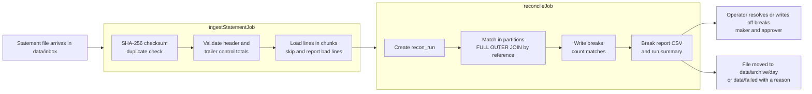

# transaction-reconciliation-batch

[](https://github.com/Darshan-05032003/transaction-reconciliation-batch/actions/workflows/ci.yml)

A Spring Batch application that reconciles the daily statement files a bank receives from other banks against its own ledger, classifies every difference, produces exception reports, lets an operations team resolve the differences with a maker/approver control, runs unattended at night and can be restarted after a failure without duplicating work.

## The problem

Every transaction a bank books on a nostro or settlement account should also appear on the statement the counterparty bank sends for that account, with the same reference, the same amount and the same value date. Every night the two sides are compared; this is **reconciliation**. Anything that does not agree is a **break**: a payment the other bank never received, a charge we never booked, an amount that differs by a few paise because of a fee, a duplicate posting, or a value date that slipped over a weekend. Breaks are money the bank cannot explain yet, so each one is investigated and either resolved (it was a timing difference) or written off (a loss booked with approval). Regulators and auditors expect the bank to show, for every break, who decided what, when and why.

The work is a batch problem: files with up to a million lines arrive in a window of a few hours, must be loaded exactly once, matched set-wise against the ledger, and reported before the morning shift starts. A file that fails half-way must resume where it stopped, never re-post what was already done.

## How a file flows through the system



Rejected files (control totals do not match) and duplicates (same content already loaded) stop after the ingest checks and are moved to `data/failed/` with a `.reason` file; nothing of them is loaded.

## Tech stack

| Area | Choice |
|---|---|
| Language and runtime | Java 21, Spring Boot 4.1, Spring Batch 6.0 |
| Database | PostgreSQL 16, Flyway migrations (application schema and the Spring Batch metadata tables), JDBC for batch and read paths, JPA only for the break resolution workflow |
| Web | Spring MVC REST API, springdoc OpenAPI, Spring Security (HTTP Basic, roles from a user table), RFC 9457 problem details |
| Observability | Spring Boot Actuator (health, info, Prometheus), Micrometer, ECS JSON logs in the prod profile |
| Tests | JUnit 5, AssertJ, Mockito, Spring Batch test support, Testcontainers PostgreSQL, Awaitility, JaCoCo |
| Operations | Bash scripts (ShellCheck in CI), cron, Docker multi-stage image, docker compose, GitHub Actions |

## Run it end to end

Requirements: Docker with compose. Java 21 is only needed to run the application or the scripts outside Docker.

```bash
cp .env.example .env
docker compose up --build -d --wait
docker compose run --rm app --spring.profiles.active=generate --date=2026-10-01 --rows=1000 --seed=42
RECON_API_PASSWORD=operator-dev scripts/run_recon.sh -f statement_BANK01_607867200891_2026-10-01.csv
docker compose exec app cat data/reports/recon_2026-10-01_1_summary.csv
```

1. `.env` holds every setting with working defaults, including the three dev users (`viewer`, `operator`, `approver`).
2. `docker compose up` builds the image, starts PostgreSQL on host port 5434 and the application on 8083, and waits until both health checks pass; Flyway creates the schema on first start.
3. The `generate` profile inserts 1,000 ledger transactions and writes the matching statement file with known breaks into the application's inbox volume (the seed decides the account number, so the file name is deterministic).
4. `run_recon.sh` ingests the file through the API, waits, reconciles it, waits again and prints the run summary: 939 matched, 71 breaks for this seed, which equals the generator's manifest.
5. The summary and the break report are CSV files in the reports folder of the data volume; the same numbers are at `GET /api/v1/recon-runs/1/summary`.

Then list the breaks of the run (`GET /api/v1/recon-runs/1/breaks` as any user), resolve one as an operator (`PATCH /api/v1/breaks/{id}/resolve`, see the API section), and stop everything with `docker compose down -v`.

To run the application on the host instead (for development): `docker compose up -d --wait postgres`, `set -a; source .env; set +a`, `./mvnw spring-boot:run`; the scripts then work against `http://localhost:8083` and `scripts/generate_data.sh -d 2026-10-01 -n 1000 -s 42` writes into `data/inbox/` on the host.

## Configuration

Every setting is read from environment variables; `.env.example` lists them with their defaults. The reconciliation settings live under `app.recon.*` and are validated at startup, so a missing folder or a chunk size of zero fails the boot instead of a job at midnight.

Profiles: `dev` (default, verbose logging), `test` (used by the test suite with Testcontainers) and `prod` (no default database credentials, fails fast when they are missing).

## Statement file format

A statement file is a UTF-8 CSV with one header, any number of data records and one trailer. Fields never contain commas, so there is no quoting.

```text
HDR,<bankCode>,<accountNumber>,<statementDate>
DTL,<bankReference>,<valueDate>,<amount>,<currency>,<description>
TRL,<recordCount>,<totalAmount>
```

| Field | Format |
|---|---|
| `statementDate`, `valueDate` | ISO date, `yyyy-MM-dd` |
| `amount`, `totalAmount` | decimal with at most two places, optional leading minus for reversals, no thousands separator |
| `currency` | three upper-case letters (ISO 4217) |
| `bankReference` | the counterparty's transaction reference; it is matched against `ledger_transaction.txn_reference` |

Control totals: `recordCount` is the number of `DTL` records in the file, malformed ones included. `totalAmount` is the sum of the amount field (the fourth column) of every `DTL` record whose amount field is a valid amount; a record whose amount cannot be read contributes nothing to the total. The same rule (`ControlTotals`) builds the trailer in the test data generator and recomputes it during ingestion, so a file can pass its control totals and still contain lines that the ingest job skips and reports. A trailer that cannot be reproduced from the file's content is treated as a rejected file.

Hand-made examples live in `src/test/resources/fixtures/`: a clean file, a file with a bad amount, a wrong column count and a bad date, and a file whose trailer total is wrong.

## Generating test data

The `generate` profile runs a one-shot command that inserts ledger transactions for a date and writes the matching statement file into the inbox folder, with deliberate breaks: amount differences in paise and in whole rupees, value dates shifted by one to three days, ledger transactions missing from the statement, statement lines with no ledger transaction, duplicated bank references, and malformed lines (bad amount, wrong column count, bad date). Malformed lines always use references that do not exist in the ledger, so skipping them during ingestion does not change the expected breaks.

```bash
scripts/generate_data.sh -d 2026-10-01 -n 1000 -s 42                                   # application running on the host
docker compose run --rm app --spring.profiles.active=generate --date=2026-10-01 --rows=1000 --seed=42   # application in Docker
```

The script builds the jar if `target/` has none (rebuild with `./mvnw -DskipTests package` after code changes), reads `DB_URL`, `DB_USERNAME` and `DB_PASSWORD` from the environment like the application, logs to stdout and `logs/generate_data.log`, and exits with 2 for bad arguments, 3 when Java 21 is missing, 4 when the build fails and 5 when generation fails. Without the script: `java -jar target/*.jar --spring.profiles.active=generate --date=2026-10-01 --rows=1000 --seed=42`.

The data is deterministic: the same date, row count and seed always produce the same ledger rows, a byte-identical statement file and a byte-identical manifest. The account number is derived from the seed, and running the same seed again replaces that account's ledger rows for the date instead of duplicating them. Ledger rows are inserted with JDBC batches of `RECON_CHUNK_SIZE` and the file is streamed line by line, so a million rows do not need a million objects in memory. The statement file appears under its final name only after the ledger rows are committed.

Next to the file the generator writes `<file>.manifest.json` with the exact count of every injected break, the expected number of matched transactions, the number of lines the ingest job is expected to load and skip, and the declared control totals. Tests of the ingest and matching jobs assert against this manifest instead of against hand-counted expectations. `data/` is ignored by git.

## Ingesting a statement file

`ingestStatementJob` takes one job parameter, `filePath`, and runs four steps:

1. `computeChecksum` streams the file through SHA-256. If a `statement_file` row with that checksum already exists, the job ends with exit status `DUPLICATE` and changes nothing. Otherwise a row with status `RECEIVED` is inserted.
2. `validateControlTotals` reads the file once, parses the header and the trailer and recomputes the control totals from the data records. On a mismatch the file is marked `REJECTED` with the reason, the job ends with exit status `REJECTED` and nothing is loaded. Otherwise the header fields and the declared count and total are stored on the `statement_file` row.
3. `loadStatementLines` reads the data records in chunks of `RECON_CHUNK_SIZE`, parses and validates each one (required fields, decimal amount, ISO date, three-letter currency) and inserts them into `statement_line` with JDBC batches, one transaction per chunk. Records that cannot be parsed are skipped and appended to `data/error/<file>.errors.csv` with their line number, the reason and the raw line, up to `RECON_SKIP_LIMIT` per run; one more bad record fails the job and the file is marked `FAILED` with the reason. Transient database errors are retried three times.
4. `analyzeStatementLines` runs `ANALYZE statement_line`, so that the reconcile job, which usually starts seconds later, is planned on fresh statistics instead of waiting for autovacuum (see the Performance section).

When the job completes, the file is marked `VALIDATED` and one summary line is logged with the declared, read, written and skipped counts and the duration. A failed execution can be restarted and resumes after the last committed chunk. Launching the same `filePath` again is refused because that job instance already completed; the same content under another name ends with `DUPLICATE`. Nothing runs at boot (`spring.batch.job.enabled=false`); the job is started through the `JobOperator`.

## Reconciling a statement file

`reconcileJob` takes the job parameter `statementFileId` (a file in status `VALIDATED`) and runs five steps:

1. `createReconRun` inserts a `recon_run` row linked to the job execution and derives the ledger window: all ledger transactions of the statement's account whose value date lies within `RECON_DATE_TOLERANCE_DAYS` of the statement date.
2. `matchCandidates` is a partitioned step. The candidate pairs are built in SQL with a `FULL OUTER JOIN` between the statement lines of the file and the ledger transactions of the window on the normalised reference (trimmed, internal whitespace collapsed, upper-cased). A reference that appears more than once in the statement is collapsed to one candidate row that carries every line number. The rows are split into partitions by a hash of the normalised reference, so both sides of a pair always land in the same partition; each partition streams its rows through a `JdbcCursorItemReader`, classifies them with the matching rules and writes breaks to `recon_break` with JDBC batches, one transaction per chunk. The number of partitions defaults to `RECON_GRID_SIZE`, which is also the size of the thread pool, and can be overridden per run with the non-identifying parameter `gridSize`.
3. `finaliseReconRun` recounts the breaks and the candidate pairs set-based, stores `matched_count` and `break_count` on the run and marks the file `RECONCILED`.
4. `writeBreakReport` streams every break of the run through a cursor into `data/reports/recon_<statementDate>_<runId>.csv`.
5. `writeRunSummary` writes `data/reports/recon_<statementDate>_<runId>_summary.csv`.

The rules are applied in this order; the first one that applies decides:

| Break type | Meaning |
|---|---|
| `DUPLICATE_IN_STATEMENT` | the same bank reference appears more than once in the file; one break per reference, listing every line, and the ledger transaction (if any) is left unmatched for the operator to decide |
| `MISSING_IN_LEDGER` | a statement line whose reference has no ledger transaction in the window |
| `MISSING_IN_BANK` | a ledger transaction in the window whose reference is not in the file |
| `AMOUNT_MISMATCH` | same reference, amounts differ by more than `RECON_AMOUNT_TOLERANCE` (amounts are compared numerically, so `100.0` equals `100.00`; signs are compared as they are) |
| `VALUE_DATE_MISMATCH` | same reference and amount, different value date; within `RECON_DATE_TOLERANCE_DAYS` the break is a warning, outside it an error, which is recorded in `details` |

Pairs that no rule claims are matches; they are counted but not stored. A failed execution can be restarted and resumes every partition after its last committed chunk, under the same run id. A file that is already `RECONCILED` is only reconciled again when the launch carries the identifying parameter `rerun` (for example the time of the request); the new run gets its own id and the previous run's breaks are kept as history.

## Reports

Every run produces two files in `RECON_REPORTS_DIR`:

- `recon_<statementDate>_<runId>.csv`: one row per break with `break_id, break_type, severity, ledger_reference, bank_reference, line_number, ledger_amount, bank_amount, ledger_value_date, bank_value_date, details, status`, grouped by break type. Fields are quoted only when they contain a comma or a quote.
- `recon_<statementDate>_<runId>_summary.csv`: `metric,value` rows with the run and file ids, the account, the statement date, `matched_count`, `break_count`, `match_rate_percent` (matched over matched plus breaks, two decimals) and one `breaks_<type>` row per break type.

## API

The API is documented with OpenAPI at `/v3/api-docs` and `/swagger-ui.html` (both need a login). Every request carries HTTP Basic credentials; errors are RFC 9457 problem details (`application/problem+json`) with a `correlationId`, and business rule violations add an `errorCode`.

| Method and path | Role | What it does |
|---|---|---|
| `POST /api/v1/jobs/ingest` `{"filePath": "<name or path inside the inbox>"}` | OPERATOR | Starts `ingestStatementJob` asynchronously; `202` with the execution id and a `Location` header. `422` when the file is missing or outside the inbox, `409` when that path was already ingested. |
| `POST /api/v1/jobs/reconcile/{statementFileId}?gridSize=&rerun=` | OPERATOR | Starts `reconcileJob` asynchronously for a `VALIDATED` file; `202`. A `RECONCILED` file needs `rerun=true`; other statuses and a run already in progress give `409`. |
| `GET /api/v1/jobs/executions/{id}` | any role | Status, exit code, parameters, timings, per-step read, write, filter, skip, commit and rollback counts, and the `statementFileId` and `reconRunId` the execution produced. |
| `POST /api/v1/jobs/executions/{id}/stop` | OPERATOR | Asks a running execution to stop at its next chunk boundary; `409` when it is not running. |
| `POST /api/v1/jobs/executions/{id}/restart` | OPERATOR | Restarts a `FAILED` or `STOPPED` execution and returns the new execution id; `409` otherwise. |
| `GET /api/v1/recon-runs/{id}/summary` | any role | Matched and break counts, match rate, breaks per type and per status. |
| `GET /api/v1/recon-runs/{id}/breaks?type=&status=&page=&size=` | any role | Paged breaks of a run (default page size 50, maximum 200), optionally filtered by break type and status. |
| `GET /api/v1/breaks/{id}` | any role | One break with its resolution history. |
| `PATCH /api/v1/breaks/{id}/resolve` `{"action": "RESOLVED" or "WRITTEN_OFF", "comment": "..."}` | OPERATOR | Resolves an `OPEN` break. A write-off whose exposure is at or below `RECON_WRITE_OFF_APPROVAL_THRESHOLD` is final; above it the break becomes `PENDING_APPROVAL`. `409` when the break is not `OPEN`. |
| `POST /api/v1/breaks/{id}/approve` `{"comment": "..."}` | APPROVER | Confirms a pending write-off. The requesting user cannot approve their own request (`422`, `errorCode` `SELF_APPROVAL`). |
| `POST /api/v1/breaks/{id}/reject` `{"comment": "..."}` | APPROVER | Sends a pending write-off back to `OPEN`; the request stays in the history. |

The exposure of a break is the amount at stake if it is written off: the difference for an amount mismatch, the full amount for a missing or duplicated transaction. Every resolution action is recorded in `recon_break_action` with the user, the time and the comment; the break row keeps the current state (`resolved_by`, `requested_by`, `approved_by` and their timestamps).

Example session:

```bash
curl -u operator:operator-dev -X POST localhost:8083/api/v1/jobs/ingest \
     -H 'Content-Type: application/json' -d '{"filePath": "statement_BANK01_607867200891_2026-10-01.csv"}'
curl -u viewer:viewer-dev localhost:8083/api/v1/jobs/executions/1
curl -u operator:operator-dev -X POST localhost:8083/api/v1/jobs/reconcile/1
curl -u viewer:viewer-dev localhost:8083/api/v1/recon-runs/1/summary
curl -u operator:operator-dev -X PATCH localhost:8083/api/v1/breaks/7/resolve \
     -H 'Content-Type: application/json' -d '{"action": "RESOLVED", "comment": "posted on the next day"}'
```

## Security

Users live in the `app_user` table with BCrypt password hashes and one or more roles in `app_user_role`:

| Role | Allowed |
|---|---|
| `VIEWER` | every `GET` under `/api/v1` |
| `OPERATOR` | launch, stop and restart jobs, resolve breaks and request write-offs |
| `APPROVER` | approve or reject pending write-offs |

Authentication is HTTP Basic over a stateless chain: no session, no cookie, CSRF disabled because there is no ambient credential for a cross-site request to reuse. `401` and `403` are problem details like every other error. `/actuator/health` is open so that scripts and the container health check can call it; `/actuator/info` and `/actuator/prometheus` need a login with any role; every other actuator endpoint is denied, and the OpenAPI documents need a login.

Under the `dev` profile the users named in `.env` (`RECON_DEV_*`) are created or updated at startup with their passwords hashed. In other profiles insert users directly, for example with a hash from `htpasswd -nbBC 10 '' 'secret' | cut -d: -f2` stored as `{bcrypt}<hash>`.

## Observability

Actuator endpoints: `/actuator/health` (open; the `db` and `dataFolders` components are shown to a logged-in user in prod and always in dev), `/actuator/info` (build, Java and OS details; needs a login) and `/actuator/prometheus` (needs a login, any role). Everything else under `/actuator` is denied. `dataFolders` checks that every configured folder is, or can be created as, a writable directory and reports the usable space of the inbox's file system.

Metrics, in Prometheus names:

| Meter | Kind | Meaning |
|---|---|---|
| `spring_batch_job_seconds` (tag `spring_batch_job_name`), `spring_batch_step_seconds` (tag `spring_batch_step_name`) | timers | Spring Batch's own job and step durations, including one series per matching partition |
| `recon_breaks_total` (tag `type`) | counter | breaks written by the reconcile job, per break type |
| `recon_match_rate_percent` | gauge | match rate of the last completed run; `NaN` until a run has completed |
| `files_rejected_total` | counter | statement files rejected by their control totals |
| `hikaricp_connections_active`, `jvm_memory_used_bytes`, ... | standard | from Boot's auto-configuration; the Hikari gauges are what the Performance section used to size the pool |

Logs: in `dev` the console is human-readable and every line shows the correlation id; in `prod` each line is one JSON object in Elastic Common Schema, with `correlationId`, `jobName` and `jobExecutionId` as fields on every line a job writes, including the lines written by the partition threads. The correlation id comes from the `X-Correlation-Id` request header (or is generated), is echoed in the response and in every problem detail, and the inbox poller creates one per file (`poll-<uuid>`). Each job ends with one summary line (counts and duration) from its listener.

## Operations

### Unattended processing: the inbox poller

The application polls `RECON_INBOX_DIR` on the Spring cron expression in `RECON_POLL_CRON` (six fields, default every five minutes; `-` disables polling, which is what the test profile does). Every poll:

1. lists the regular `*.csv` files in the inbox in file-name order and ignores everything else (`.part` files, the generator's `.manifest.json`, sub-folders);
2. picks up a file only when two consecutive polls have seen it with the same size and modification time, so a file that is still being copied in is left alone; a sender that writes `<name>.csv.part` and renames it afterwards is never at risk in the first place;
3. runs `ingestStatementJob` and, when the file was loaded, `reconcileJob`, both synchronously, with `launchedBy=inbox-poller` and an identifying `receivedAt` parameter, so that a file re-sent under the same name is a new job instance and the checksum step decides whether its content is new;
4. moves the file out of the inbox with an atomic rename (`Files.move` with `ATOMIC_MOVE`; the inbox, archive and failed folders must be on the same file system):

| Outcome | Where the file goes |
|---|---|
| ingested and reconciled | `RECON_ARCHIVE_DIR/<yyyy-MM-dd>/<file>`, dated by the processing day in the application's clock (UTC) |
| `DUPLICATE` (content already ingested) | `RECON_FAILED_DIR/<file>` plus `<file>.reason` naming the earlier `statement_file` |
| `REJECTED` (control totals) | `RECON_FAILED_DIR/<file>` plus `<file>.reason` with the validator's message |
| a job ended `FAILED` | `RECON_FAILED_DIR/<file>` plus `<file>.reason` with the failure and the execution id to restart |
| the job could not be launched at all (for example the database was unreachable) or the file is not readable | stays in the inbox and is retried on the next poll |

A name that already exists in the target folder is kept apart with a counter (`statement.csv`, `statement.1.csv`, ...). The `.reason` file is plain text:

```text
file: statement_BANK01_607867200891_2026-10-01.csv
outcome: REJECTED
time: 2026-10-02T01:05:00Z
job: ingestStatementJob execution 42
statementFileId: 7
reason: trailer declares 1016 records totalling 25419.77 but the file contains 1015 records totalling 25319.77
```

Only one poll runs at a time within an instance; a poll that is still busy when the next one is due makes the next one return at once. Two instances sharing an inbox are not coordinated (each would try the same file; the second ends `DUPLICATE` or is refused by the job repository), so run one poller per inbox.

### Scripts

All scripts in `scripts/` use `set -euo pipefail`, `getopts`, a `usage()` (`-h`), distinct exit codes, and log with timestamps to stdout and to `logs/<script>.log`. They read `RECON_API_URL` (default `http://localhost:8083`), `RECON_API_USER` (default `operator`) and `RECON_API_PASSWORD` where they talk to the API. ShellCheck runs over them in CI.

| Script | What it does | Exit codes |
|---|---|---|
| `generate_data.sh -d <date> -n <rows> [-s <seed>]` | generates ledger rows and a statement file with known breaks (see above) | 2 usage, 3 no Java 21, 4 build failed, 5 generation failed |
| `run_recon.sh -f <file> [-u user] [-p password] [-H host] [-t timeout] [-b break-threshold]` | ingests a file from the inbox through the API, waits, reconciles, waits, prints the run summary | 2 usage, 3 no curl, 4 API error or unreachable, 5 a job ended `FAILED`/`STOPPED`, 6 timeout, 7 `DUPLICATE`, 8 `REJECTED`, 9 more breaks than `-b` allows |
| `archive_old.sh -d <days> [-a archive-dir] [-n]` | turns archive day folders older than `<days>` days into `<date>.tar.gz`; removes a folder only after `tar -tzf` lists the archive and every file of the folder is found in it; safe to re-run, `-n` is a dry run | 2 usage, 3 no tar or archive folder, 5 an archive did not verify (its folder is kept) |
| `check_health.sh [-H host] [-t timeout]` | calls `/actuator/health` | 0 `UP`, 1 unreachable or not `UP`, 2 usage |

`run_recon.sh` sends the file name only; the application resolves it inside its own inbox, so the script also works against a container. Prefer `RECON_API_PASSWORD` over `-p`, which is visible to `ps`.

### Scheduling with cron

The poller already picks up files on its own; cron is for the surrounding chores and for shops that prefer an explicit nightly run over polling. Percent signs must be escaped in a crontab.

```crontab
# minute hour day month weekday  command
*/5  *  *  *  *   cd /opt/recon && scripts/check_health.sh >/dev/null 2>&1 || logger -t recon "health check failed"
30   1  *  *  *   cd /opt/recon && . /etc/recon/api.env && scripts/run_recon.sh -f "statement_BANK01_607867200891_$(date +\%F).csv" -b 500 >/dev/null 2>&1
0    3  *  *  *   cd /opt/recon && scripts/archive_old.sh -d 30 >/dev/null 2>&1
```

`/etc/recon/api.env` exports `RECON_API_URL`, `RECON_API_USER` and `RECON_API_PASSWORD` and is readable by the cron user only. The scripts' own log files under `logs/` keep the details; the redirects keep cron mail quiet. Run either the poller or the nightly `run_recon.sh` line for a given inbox, not both: the script does not move files, so the poller would pick the same file up later and move it to `data/failed/` as a `DUPLICATE`.

### Restarting a failed execution

A failed execution keeps every chunk that was committed. `POST /api/v1/jobs/executions/{id}/restart` creates a new execution of the same job instance that skips the completed steps and resumes the failed ones after their last commit; for the partitioned matching step only the partitions that did not complete run again, each from its own saved position, and the run keeps its id. The execution id is in the `.reason` file, in the script log and in `batch_job_execution`.

```bash
curl -u operator -X POST localhost:8083/api/v1/jobs/executions/42/restart
curl -u viewer localhost:8083/api/v1/jobs/executions/43
```

A failed `ingestStatementJob` reads the file again from the path it was launched with, so move the file from `data/failed/` back to the inbox before restarting; the poller leaves it alone for one poll interval, which is the window to issue the restart. A failed `reconcileJob` does not need the file.

### Troubleshooting a failed nightly run

1. Is the application up? `scripts/check_health.sh`; if not, check the database (`docker compose ps`, `docker compose logs postgres`) and the application log.
2. Is the file still in `data/inbox/`? Then it was never picked up: it does not end in `.csv`, it is still changing size, it is not readable by the application user, or polling is disabled (`RECON_POLL_CRON=-`). The application log says `Inbox poll handled n file(s)` on every poll that found something.
3. Is it in `data/failed/`? Read `<file>.reason`:
   - `REJECTED`: the trailer does not match the data records; ask the counterparty for a corrected file. Nothing was loaded.
   - `DUPLICATE`: the content was already processed as the `statement_file` named in the reason; nothing to do unless the earlier run itself failed.
   - `FAILED` during ingest with `Skip limit of 'n' exceeded`: more malformed lines than `RECON_SKIP_LIMIT`; the skipped lines and reasons are in `data/error/<file>.errors.csv`. Fix the file or the limit, then move the file back and restart, or re-send a corrected file.
   - `FAILED` for any other reason (database unavailable, disk full): fix the cause and restart the execution as described above; no data is duplicated by a restart.
4. Is it in `data/archive/<date>/`? Then both jobs completed; look at the run with `GET /api/v1/recon-runs/{id}/summary` and the report in `data/reports/`. A high break count usually means the ledger for that day was not posted yet or the wrong date window; the breaks list which side is missing.
5. `run_recon.sh` exit codes tell the same story without reading files: 7 duplicate, 8 rejected, 5 a job failed (the log shows the restart command), 6 the job did not finish in time (it is still running; poll the execution), 9 the run completed but has more breaks than allowed.
6. `AtomicMoveNotSupportedException` in the log means the inbox and the archive or failed folder are on different file systems; keep `data/` on one volume.
7. The application refuses to start with a message naming `DB_POOL_SIZE` and `RECON_GRID_SIZE` when the connection pool is smaller than `2 * RECON_GRID_SIZE + 2`; raise the pool or lower the grid size.

### Running in Docker

The `Dockerfile` builds in two stages: a JDK stage runs the Maven wrapper (dependencies are resolved in their own layer and cached between builds) and extracts the Boot jar into layers; the runtime stage is `eclipse-temurin:21-jre` with the dependency, loader, snapshot and application layers copied separately, so a code change rebuilds only the last and smallest layer. The application runs as the non-root user `recon` (uid 10001), with `JAVA_TOOL_OPTIONS=-XX:MaxRAMPercentage=75.0 -XX:+ExitOnOutOfMemoryError` so the heap follows the container memory limit (1 GB in `docker-compose.yml`), and a `HEALTHCHECK` on `/actuator/health`.

All five data folders live under one volume, `/app/data` (`recon-data` in compose), which keeps the inbox, archive and failed folders on one file system for the atomic moves. To hand a real file to the containerised application: `docker compose cp statement.csv app:/app/data/inbox/`; the poller picks it up, or `scripts/run_recon.sh -f statement.csv` runs it at once. Reports and error files are read the same way (`docker compose exec app ls data/reports`, `docker compose cp app:/app/data/reports ./reports`). `docker compose logs -f app` follows the application log; `docker compose down -v` removes the containers and both volumes.

CI (`.github/workflows/ci.yml`) runs `./mvnw -B clean verify`, keeps the JaCoCo report as a build artifact, lints the scripts with ShellCheck and builds the Docker image.

## Performance

Measured on 2026-10-23 with `scripts/benchmark.sh`, which for every chunk size starts the application with that `RECON_CHUNK_SIZE`, then for every repetition and row count generates a fresh data set, ingests it through the API and reconciles it once per grid size (re-runs of the same file), and records every job's own duration from `GET /api/v1/jobs/executions/{id}`:

```bash
docker compose down -v && docker compose up -d --wait
./mvnw -DskipTests package
RECON_API_PASSWORD=operator-dev scripts/benchmark.sh      # defaults: -n 100000,1000000 -c 100,500,2000 -g 1,2,4 -r 2
```

Machine: Intel Core i5-13500H (12 cores, 4 performance and 8 efficiency, 16 hardware threads), 15.3 GiB RAM, NVMe SSD (WD PC SN740), Linux 6.8, OpenJDK 21.0.12.1, PostgreSQL 16.15 running in Docker from this repository's `docker-compose.yml` (`postgres:16-alpine`, default server settings; the application sets `work_mem` to 64MB per session). The desktop was in use (browser, IDE) but no other build ran during the measurement; load average 1.68 at the start. The whole matrix took 12 minutes. A 1,000,000-row data set is an 81 MB file with about 1,019,000 data records, of which about 9,000 are malformed and skipped (the benchmark raises the skip limit to 2% of the row count). Every run found exactly the number of breaks its manifest predicted.

Job durations in seconds, both repetitions (`first / second`). The first job of each kind after an application start includes JIT warm-up, which is why most 100,000-row pairs differ by more than 20%; at 1,000,000 rows only the chunk 2000, grid 2 pair differs by more than 20%.

| Ingest, chunk size | 100,000 rows | 1,000,000 rows | commits per 1,000,000 lines |
|---|---|---|---|
| 100 | 4.06 / 2.93 | 27.72 / 28.10 | 10,190 |
| 500 | 3.97 / 2.67 | 27.31 / 24.80 | 2,039 |
| 2000 | 3.58 / 2.39 | 24.62 / 21.51 | 510 |

| Reconcile, chunk size | grid size | 100,000 rows | 1,000,000 rows |
|---|---|---|---|
| 100 | 1 | 3.76 / 2.72 | 30.61 / 29.06 |
| 100 | 2 | 2.43 / 2.36 | 21.99 / 21.86 |
| 100 | 4 | 1.52 / 1.62 | 16.39 / 15.74 |
| 500 | 1 | 3.31 / 1.96 | 21.20 / 20.54 |
| 500 | 2 | 2.41 / 1.63 | 16.72 / 16.23 |
| 500 | 4 | 1.92 / 1.66 | 10.60 / 10.73 |
| 2000 | 1 | 3.02 / 1.84 | 27.05 / 24.01 |
| 2000 | 2 | 1.39 / 1.52 | 15.74 / 13.01 |
| 2000 | 4 | 1.18 / 0.96 | 11.50 / 9.73 |

What the numbers say:

- Four partitions reconcile 1,000,000 rows about twice as fast as one (chunk 500: 10.6 s against 20.5 s). Each partition holds two connections; the Hikari gauges peaked at 8 active connections with none pending during a grid-4 run, so the default pool of 10 is enough up to grid size 4 and `DB_POOL_SIZE` must be at least `2 * RECON_GRID_SIZE + 2` beyond that (checked at start-up).
- Larger chunks help the ingest (fewer commits) and the partitioned reconcile, but chunk 2000 with a single partition was slower than chunk 500 in both repetitions; the cause was not investigated.
- `EXPLAIN (ANALYZE, BUFFERS)` of the pairing query on a 1,000,000-line file: the whole query (no partition predicate) runs in 5.1 to 6.0 s and sorts about 200 MB on disk; one of four partitions runs in 2.9 to 3.7 s at the server default `work_mem` of 4MB and in 1.6 s at 64MB, where its sorts and hash table stay in memory. Expression indexes on the normalised reference (statement side, ledger side, both) changed the plan but not the time, so none was added. Driver-side `reWriteBatchedInserts` halved the generator's 1,000,000-row insert (21.0 and 23.3 s to 10.5 and 12.5 s) and cut the ingest from 34.8 s to 25.3 s (one run each, chunk 500).
- Memory stays flat. With `JAVA_OPTS=-Xmx256m` the application generated, ingested (19.3 s) and reconciled (grid 4, 12.5 s) a 1,000,000-row data set without an `OutOfMemoryError`: 310 young collections, no full collection, at most 77 MB of live heap after a collection, 248 MB committed, and a peak resident set of 520 MB for the whole JVM (`VmHWM`). The generator ran with the same heap and peaked at 41 MB live.

Results are written as CSV to `data/benchmark/` (ignored by git), one row per job with the step counts the application reported, so every number above can be traced to a job execution.

## Testing

```bash
./mvnw -B clean verify
```

Integration tests start a disposable PostgreSQL 16 with Testcontainers, so Docker must be running. The suite has 309 tests: unit tests for the matching rules, the file format, the resolution state machine and the scripts' API counterparts, Spring Batch tests for each job (including a restart after an injected mid-run failure), MockMvc tests for every endpoint and role with real users and HTTP Basic, and a poller test with temp folders.

JaCoCo writes `target/site/jacoco/index.html` on every `verify`. Measured on this suite: 97.04% line coverage (1,576 of 1,624 lines), 88.96% branch coverage, after excluding the application entry point, Spring `*Configuration` classes and data-only records (listed in `pom.xml`). The build fails below 95% line coverage, which is the measured number rounded down to the nearest 5%; raise the threshold in `pom.xml` when coverage goes up, never lower it to make a build pass.
